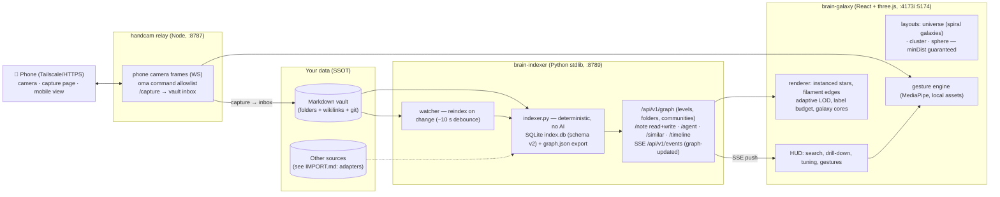

# Architecture

Brain Galaxy is a local-first system of two small services and one browser
app. Everything talks over localhost; nothing leaves your machine.

## The three pieces

### 1. brain-indexer — reading is strictly separated from displaying

- `indexer.py` scans a markdown vault **deterministically** (no AI): titles,
  tags, word counts, wikilinks. Links resolve the way Obsidian does
  (exact path → unique name → same-folder preference → unresolved with reason).
- Output is a SQLite index (`index.db`, WAL, FTS5): `nodes`, `links_raw`
  (with resolution status), `edges`, `folders` (aggregate levels),
  `communities` (label propagation over wikilinks — deterministic).
  `graph.json` is a compatibility export.
- `server.py` serves a level-of-detail API (`/api/v1/graph?folder=|community=`,
  level 0 = folder super-nodes, ≤ 100 kB), note read/write (write commits to
  git and reindexes), semantic search (via `qmd`, optional), and an SSE
  stream (`graph-updated`) so the UI refreshes itself after edits (~20 s).
- A watcher thread reindexes on change; a nightly timer is the safety net.

### 2. brain-galaxy — the universe

- **Layouts** (`src/data/layout.ts`): *universe* — every cluster becomes a
  spiral galaxy (core = heaviest notes, mass = degree + words; 3 arms;
  flattened disk), galaxies distributed golden-angle over a wide disk with
  voids between them. All layouts end with an enforce pass that guarantees
  **zero node overlaps** (budget-checked) and radius ∝ ∛N.
- **Renderer** (`src/scene/`): one InstancedMesh for all satellite stars +
  individual hub stars with glow sprites; edges as a single shader geometry
  with adaptive resolution (135 → 18 verts/edge) and an edge budget (9 000);
  galaxy cores (bulge + halo), procedural nebulae, star field with
  diffraction spikes, asteroid belt. Labels are budgeted (~40 hubs).
- **HUD** (`src/hud/`): command palette, note detail (read/edit/save),
  📁/🧠 grouping toggle, drill-down breadcrumb, tuning panel (glow, sizes,
  edges, importance filter ≥ N links, layout).
- **Gesture engine** (`src/lib/handControl.ts`): one engine, two input
  sources (phone relay or webcam), hysteresis thresholds, anti-Midas
  delays. See [GESTURES.md](GESTURES.md).

### 3. handcam — phone as sensor & remote control

Node relay on :8787 (localhost; phone connects via Tailscale serve or LAN):

- Camera: phone page captures JPEG frames → WebSocket → viewers (galaxy,
  demo stages). Latest-frame forwarding, drop-on-slow, status broadcast
  (`{phone:true/false}`) so the UI can show connection state.
- Commands: viewers may send `{"oma": …}` — executed only against a fixed
  **allowlist** (voxtype dictation start/stop, window/workspace focus via
  Hyprland IPC, app launch table). No arbitrary execution, ever.
- Capture: `POST /capture` writes a markdown note (sanitized, size-capped)
  into the vault inbox — the watcher picks it up and it appears in the
  universe within ~30 s.

## Performance budget (enforced)

| Budget | Target | Measured |
| --- | --- | --- |
| Boot to first frame | ≤ 3 s | ~1.0 s (700 nodes) |
| Full reindex, 10 000 notes | ≤ 60 s | 1.6 s |
| Node overlaps | 0 | 0 (700 and 10 000 nodes) |
| LOD level-0 payload | ≤ 100 kB | 4.3 kB |
| Gesture→action latency | ≤ 150 ms | measure with `?latency=1` clock |

Benchmarks: `scripts/bench-boot.mjs` (boot + fps via CDP),
`make_synth_vault.py` (deterministic 10k vault) in brain-indexer.

## Design decisions (short)

- **Markdown + git is the source of truth**; every index is derived and
  rebuildable. SQLite is the machine index, `.md` stays the human layer.
- **Determinism first**: communities, layouts and link resolution are
  reproducible without network or models. AI is opt-in at the edges
  (semantic search, importer agent).
- **Allowlist over injection**: system actions are enumerated server-side;
  no generic input synthesis (ydotool) by design.
- **One fixed look** ("cosmos"): a single visual language instead of themes.
