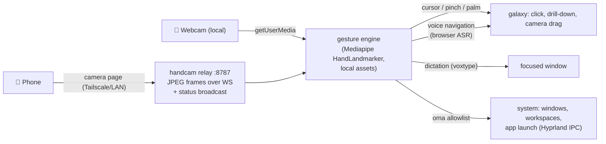

# Gesture control & phone capture

One gesture engine, two input sources, zero cloud.



## Setup

```bash
# relay (gesture commands + phone camera + capture)
node handcam/server.js            # :8787 (localhost)
# offline-capable hand tracking assets (MediaPipe 0.10.14, pinned)
bash scripts/fetch-mediapipe.sh
```

- **Webcam:** open the galaxy, click the **✋ button** (top right). Done.
- **Phone:** click the **📱 button** in the galaxy — a panel with a QR code,
  live status and the phone URL opens. Scan the QR with your phone, allow the
  camera, then start gestures (✋ in the panel or `?hands=1`). The phone URL
  is remembered (edit it in the panel; e.g. `https://<machine>.ts.net/handcam`
  when the relay is exposed via `tailscale serve --set-path=/handcam`).

  The galaxy itself is phone-friendly too: `https://<machine>.ts.net/galaxy/`
  (mobile layout, touch orbit/zoom, notes as bottom sheets).
- The ✋ button doubles as status: 🟢 phone streaming · 🟡 relay up, phone
  disconnected · 🔴 relay down.

## Gestures (postures — the one style)

The letters experiment is retired (hard to draw reliably mid-air). The
posture vocabulary is the single gesture style again: point = cursor,
circle = select, fist = menu, raised hand = dictation, folded hands =
librarian, two palms = zoom, snake = fly, swipe = neighbor jump.

## Phone microphone (round 🎤 button)

The handcam phone page has a round **mic button** (bottom right, above
➕ Notiz). **Hold to talk** — the phone transcribes live (Android Chrome
speech recognition), release to send the text to the galaxy over the
existing relay. The galaxy interprets it:

| You say | What happens |
| --- | --- |
| „menü" / „menu" | Opens the menu — **and it stays open** until you close it |
| „schließen" / „close" | Closes the current thing: modal → panel → selected note |
| „suche …" / „search …" | Opens search with the rest as query |
| „librarian …" | Sends the rest to the Librarian input and submits (just „librarian" focuses it) |
| „notiz …" | Captures the rest as a note into your vault inbox |
| „autopilot" | Toggles the autonomous flight easter egg |
| anything else | **Dictation**: into the focused editor (if one is open) AND the clipboard |

Voice commands are the same actions the gestures trigger — one system,
two input paths (hand or voice), both arrive as the same events.

### Flying (improved)

Two open hands, wave them alternately left/right (snake motion) → forward
thrust; lean the hand pair left/right of screen center to steer. Zoom and
fly are disambiguated by motion direction: moving hands apart/together is
zoom, lateral waving is flight. Both thresholds are **calibrated to your
wave** (see below) — comfortable speed measured from your own motion.

## Calibrating your hands (key `C`) — LIVE wizard

The wizard measures **your** thresholds *while the feature runs for real*:
each step enables exactly one gesture in the engine (all others are
suppressed so steps can't shoot each other — the OK step no longer closes
the modal, the fist step opens the menu on purpose so you see it working).

1. **Per-hand steps**: relaxed open, pointing, OK and fist are sampled
   **separately for right and left hand** (right = selector, left = modes).
2. **Folded hands** step measures the Librarian distance.
3. **Zoom step (live)**: both hands open, move apart/together at a
   comfortable pace — the universe actually zooms while you do it, and your
   comfortable motion speed sets the zoom gain (`zoomK`), so zoom can't be
   too strong for you.
4. **Fly step (live)**: wave both hands — you actually fly; your wave
   amplitude sets thrust threshold and power.

Quality machinery: 1.2 s settle time per step, only **steady frames**
(motion < 16 px) are sampled, robust 25/75 % percentile bands with minimum
canyon widths (otherwise factory defaults are kept), and any step with too
few usable samples repeats itself once. The result shows bands, sample
counts and all calibrated values; „Erneut kalibrieren" restarts, and
„Zurücksetzen" restores factory defaults. Values persist locally and apply
live — press **C** again after changing camera, lighting or seat.

## Where dictated text goes

Dictation types into the **focused element/window** (voxtype):

- **Inside the galaxy** (reliable): open a note → *Bearbeiten* → the editor
  keeps focus → dictation lands *in the note*.
- **System-wide**: focus the target app first (Alt-Tab / voice workspace
  commands), then fist.
- The on-screen hint names the current target while dictating.

## Phone capture

The phone page has **➕ Notiz**: title, category chips (💡 Idee, 📌 Projekt,
📚 Thema, 🔧 System, ❓ Offen), text → *Ins Brain einsammeln*. The relay
writes a sanitized markdown file into your vault inbox
(`HANDCAM_INBOX`, default `~/Vault/00_inbox`); the watcher reindexes and the
note appears as a new star within ~30 s. Set `HANDCAM_INBOX` to route
captures anywhere else.

## Security model

- The relay executes **only allowlisted commands** (voxtype start/stop,
  fixed window/workspace dispatches, a fixed app-launch table). No
  arbitrary shell, ever.
- Frames exist only on your LAN/tailnet; the relay binds to 127.0.0.1 and
  is exposed to the phone only through your own tunnel (e.g. Tailscale
  serve) or LAN.
- Capture input is sanitized (control characters stripped, 20 kB text cap,
  100 kB request cap, category whitelist, markdown-only writes).
- MediaPipe runs **in your browser** with locally vendored assets — the
  gesture pipeline works with the internet turned off.
