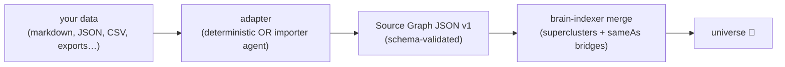

# Importing your data — adapters, schema, and the importer agent

Brain Galaxy is **modular by data source**. The universe is built from one
or more *sources*; each source becomes its own **supercluster** (region of
space), each group inside a source becomes a **galaxy**, topics form the
spiral arms. Bringing data in follows one contract:



## The hierarchy (standardized)

| Concept | Visual | Meaning |
| --- | --- | --- |
| Source | Supercluster (region) | One vault / system (e.g. `main-vault`, `github`, `mail`) |
| Group | Galaxy (spiral disk) | Container inside the source — adapter picks the dimension: project, folder, repo, category, or even device |
| Community | Spiral arm | Topic cluster, detected deterministically from links |
| Entity | Star (mass = importance) | Note, repo, mail, neuron… |
| Relation | Filament | Typed edge: `wikilink`, `references`, `mentions`, `sameAs` |
| Origin | (filter/overlay) | Where an entity came from: `{source, device?, uri, retrievedAt}` — devices are a *lens*, not a layout axis |

Cross-source identity uses `sameAs` edges: deterministic matches (same path,
same URL) are automatic; semantic matches are only ever created as flagged
suggestions (human confirms) — the classic hybrid entity-resolution rule.

## Source Graph JSON v1 (the contract)

Every adapter outputs this, validated against `schema/source.schema.json`:

```json
{
  "schema_version": 1,
  "source": {
    "id": "main-vault",
    "name": "Main Vault",
    "type": "markdown-vault",
    "group_dimension": "folder"
  },
  "groups": [
    { "id": "projects", "label": "Projects", "dimension": "folder" }
  ],
  "nodes": [
    {
      "id": "projects/idea.md",
      "label": "The idea",
      "group": "projects",
      "category": "note",
      "importance": 0.7,
      "origin": { "uri": "file://…/idea.md", "device": "laptop", "retrievedAt": "2026-09-10T10:00:00Z" },
      "props": { "words": 412, "mtime": "2026-09-09" }
    }
  ],
  "edges": [
    { "source": "projects/idea.md", "target": "projects/plan.md", "type": "wikilink", "weight": 1 }
  ]
}
```

**Standard categories** (fixed vocabulary, SKOS-style — map your types onto
these): `note`, `project`, `topic`, `person`, `system`, `message`,
`reference`, `media`.

Field rules: `id` unique per source; `category` from the vocabulary;
`importance` 0..1 (drives star mass — default derived from degree);
`origin.uri` strongly recommended so `sameAs` matching works.

## Ways to import

### 1. Built-in: markdown vault (deterministic, zero config)

Obsidian/plain-markdown folders work as-is — that is the default brain-indexer
flow (see README). Groups = top folders, communities = link structure.

### 2. Built-in: generic JSON graph (deterministic)

Any system that can dump nodes+edges exports Source Graph JSON directly.
Point the indexer at it — no code required.

### 3. Custom adapter (deterministic, any language)

Write a small program that reads your system and prints Source Graph JSON
to stdout. Contract: `your-adapter --source_id=foo` → one JSON document.
Validate locally:

```bash
python3 -m json.tool my_source.json     # syntax
# schema check: python3 -c "import jsonschema, sys; jsonschema.validate(
#   json.load(open('my_source.json')), json.load(open('schema/source.schema.json')))"
```

Tips for good adapters: prefer stable ids (URIs, paths) over row numbers;
map types honestly onto the category vocabulary; emit `sameAs` edges when
you *know* two entities are identical; keep one adapter per source.

### 4. The importer agent (for messy, personal, one-off data)

Deterministic mapping is impossible for arbitrary personal exports
(Evernote XML, Notion dumps, 15 years of folder chaos). For those, use the
**importer agent**: an LLM agent (runs locally with your own tool, e.g.
Claude Code) that reads samples of your data, **proposes a mapping**,
generates the adapter, and validates the output — with you as the
checkpoints. It never invents data: every output row traces back to an
input row (the agent must record provenance).

The workflow (documented in `importers/agent/AGENT-PROMPT.md`):

1. **Survey**: agent samples your export, inventories structures/types.
2. **Mapping proposal**: fields → schema, types → category vocabulary,
   groups → group dimension. You approve or correct.
3. **Adapter generation**: agent writes the adapter + test fixtures from
   *your real samples*.
4. **Validation**: schema check + sanity queries (counts, dangling edges,
   provenance coverage). Failures loop back to 3.
5. **Import & review**: merged into the universe; suggested `sameAs` edges
   are flagged for your confirmation.

The agent is *tooling, not a runtime dependency*: after import, everything
is deterministic files you can re-run and diff.

## Merging model (what the indexer does)

- Every source becomes a supercluster: its groups are placed as galaxies in
  one region; source id prefixes node ids internally.
- Inter-source `sameAs` edges render as bridges between superclusters.
- Re-imports are idempotent: same source id + same node ids → same stars.
- A `sources.json` manifest registers adapters (id, command, schedule).

## Status

- ✅ Contract + schema (this document) · ✅ markdown adapter (default flow)
- 🔜 multi-source merge + supercluster layout (roadmap S16)
- 🔜 `schema/source.schema.json` + `importers/agent/` scaffold
